# HelpDesk — DevOps Capstone

**Name:** Vansh Malhotra  
**Roll No:** 24bcs10268  
**Repository:** https://github.com/vansh-commits/devops-capstone

**HelpDesk** is a customer-support ticketing app. Support agents log tickets from customers, set a
priority (Low → Urgent) and category (Bug, Billing, Access, Other), move them through
`Open → In progress → Resolved → Closed`, and watch live KPIs (open, in-progress, resolved, urgent).

The point of the project is the delivery path: the same app runs on a laptop with Docker, is tested and
security-scanned in GitHub Actions, published to GHCR, deployed to Kubernetes (kind) with Helm (Ingress, HPA,
Prometheus/Grafana) and kept in sync by Argo CD (GitOps). Terraform describes the AWS VPC + EKS target.

```text
Developer ── git push ──► GitHub Actions
                            ├─ pytest + coverage, React build
                            ├─ SAST  (CodeQL)
                            ├─ SCA   (pip-audit, npm audit)
                            ├─ Secret scan (Gitleaks)
                            ├─ IaC scan (Trivy config) + terraform fmt/validate
                            ├─ Docker build ─► Trivy image scan (HIGH/CRITICAL gate)
                            ├─ push ghcr.io/vansh-commits/helpdesk-{backend,frontend}:<git-sha>  (amd64 + arm64)
                            ├─ deploy to throwaway kind cluster (helm --wait + smoke test)
                            └─ bump image tag in helm/helpdesk/values-gitops.yaml
                                              │
                                              ▼
                     Argo CD (local kind) ── syncs ──► Kubernetes
                                                         ├─ frontend (React + Nginx) x2
                                                         ├─ backend  (FastAPI) x2..5 (HPA)
                                                         ├─ PostgreSQL StatefulSet + PVC
                                                         ├─ Ingress  helpdesk.local  (/ → UI, /api → API)
                                                         └─ ServiceMonitor ─► Prometheus ─► Grafana
Terraform ─► AWS VPC (2 public + 2 private subnets, NAT) + EKS managed node group
```

## Tech stack

| Layer | Tools |
|---|---|
| Frontend | React 19 + Vite, responsive CSS (desktop / tablet / phone), served by unprivileged Nginx |
| Backend | FastAPI, SQLAlchemy 2, Alembic, Pydantic validation, Prometheus instrumentator |
| Database | PostgreSQL 16 |
| Tests | Pytest + pytest-cov against an isolated SQLite DB (13 tests) |
| Containers | Multi-stage Dockerfiles, non-root users, Docker Compose |
| CI/CD | GitHub Actions, GHCR, commit-SHA image tags |
| Security | CodeQL (SAST), pip-audit + npm audit (SCA), Gitleaks (secrets), Trivy (images + IaC) |
| IaC | Terraform (terraform-aws-modules VPC + EKS) |
| Kubernetes | kind, Helm, ingress-nginx, HPA + metrics-server, ConfigMap/Secret, probes |
| Observability | kube-prometheus-stack (Prometheus + Grafana), custom dashboard |
| GitOps | Argo CD |

## API

| Method | Path | Purpose |
|---|---|---|
| GET | `/health` | Liveness: process is up |
| GET | `/ready` | Readiness: database reachable |
| GET | `/metrics` | Prometheus metrics |
| GET | `/api/tickets?status=&priority=` | List / filter tickets |
| GET | `/api/tickets/stats` | KPI counts |
| GET | `/api/tickets/{id}` | One ticket |
| POST | `/api/tickets` | Create ticket |
| PUT | `/api/tickets/{id}` | Update ticket |
| DELETE | `/api/tickets/{id}` | Delete ticket |

## Repository layout

```text
backend/            FastAPI app, Alembic migrations, pytest suite, Dockerfile
frontend/           React app, Nginx template, multi-stage Dockerfile
docker-compose.yml  Full local stack (postgres + backend + frontend)
.github/workflows/  DevSecOps CI/CD pipeline
helm/helpdesk/      Helm chart (values.yaml, values-dev.yaml for kind, values-gitops.yaml for Argo CD)
k8s/                Namespace + kind cluster config
argocd/             Argo CD Application
monitoring/         kube-prometheus-stack values + Grafana dashboard
terraform/          AWS VPC + EKS (fmt/validate; not applied)
troubleshooting/    Deliberately broken manifests (ImagePull, Service, CrashLoop, Pending)
scripts/            kind bootstrap + HPA load generator
screenshots/        Demo evidence used below
```

## Rubric → evidence

| Module | Pts | Where |
|---|---|---|
| M1 Application | 10 | [Demo 3](#3-deployment-1--docker-compose): Swagger CRUD, UI (desktop/tablet/phone), Alembic table |
| M2 Testing | 10 | [Demo 2](#2-tests-pytest): 13 tests, `pytest.ini`, `tests/conftest.py` (SQLite test DB) |
| M3 Git/GitHub | 5 | [Demo 1](#1-git-and-github): commit history, `.gitignore` |
| M4 Docker | 10 | [Demo 3](#3-deployment-1--docker-compose): compose stack, non-root users, multi-stage frontend |
| M5 CI/CD | 15 | [Demo 4](#4-cicd--github-actions): pipeline on push to `main`, pytest, builds, GHCR with SHA tags |
| M6 DevSecOps | 5 | [Demo 5](#5-devsecops--security-gates): CodeQL, SCA, Gitleaks, Trivy gate (pass + fail), CVE explanation |
| M7 Terraform | 15 | [Demo 6](#6-terraform--aws-vpc--eks): `terraform init`, `fmt`, `validate`, VPC + EKS code, tfvars example |
| M8 Kubernetes + Helm | 15 | [Demo 7](#7-deployment-2--kubernetes-kind--helm): kind, Helm install/upgrade/rollback, Ingress, HPA |
| M9 Observability | 10 | [Demo 8](#8-monitoring--prometheus--grafana): `/metrics`, Prometheus targets UP, Grafana dashboard |
| M10 Presentation | 5 | This README + [Demo 10](#10-deployment-3--argo-cd-gitops): commit → pipeline → deployment updates |

---

# Demo

All commands run from the repository root on macOS (zsh) with Docker Desktop and the local kind cluster
`project-cluster`.

## 1. Git and GitHub

```bash
git log --format='%h %ad %an  %s' --date=format:'%Y-%m-%d %H:%M'
cat .gitignore
```

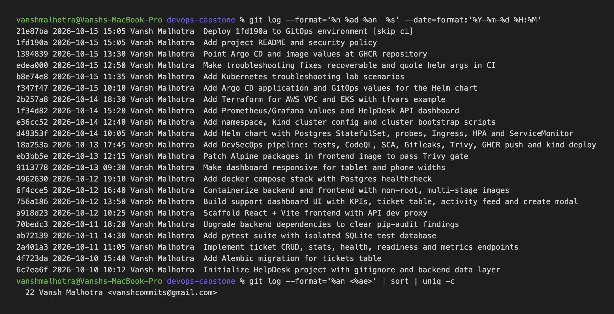

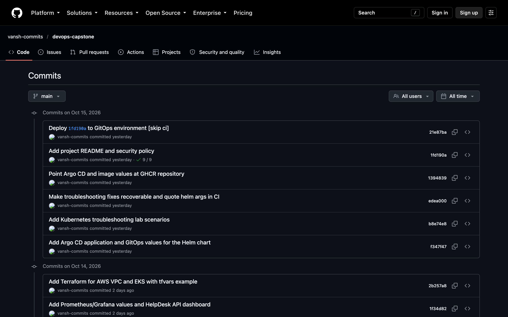

`.gitignore` keeps `.env`, `__pycache__/`, `node_modules/`, `.venv/`, Terraform state and `*.tfvars` out of Git:

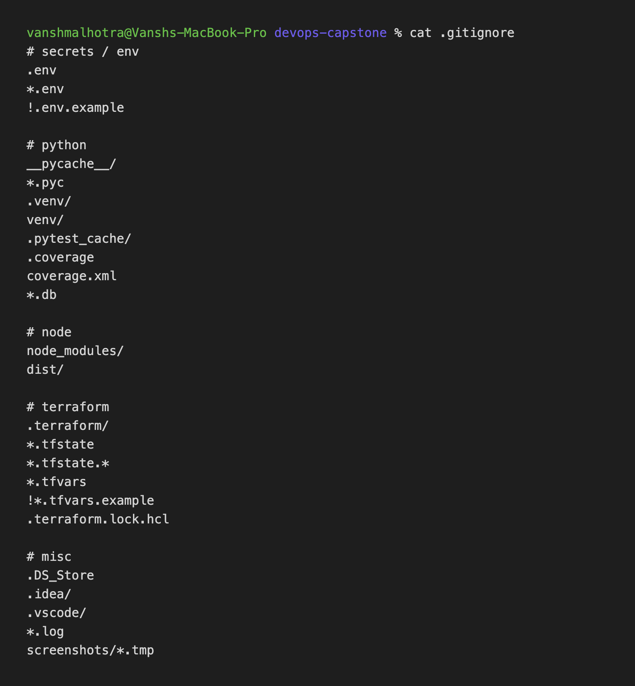

## 2. Tests (pytest)

```bash
cd backend
python3 -m venv .venv && source .venv/bin/activate
pip install -r requirements-dev.txt
pytest -v --cov=app --cov-report=term-missing
```

13 tests cover health, readiness, metrics and all CRUD endpoints, including validation (422) and not-found (404)
cases. `tests/conftest.py` points `DATABASE_URL` at a throwaway SQLite file, so tests never touch PostgreSQL.

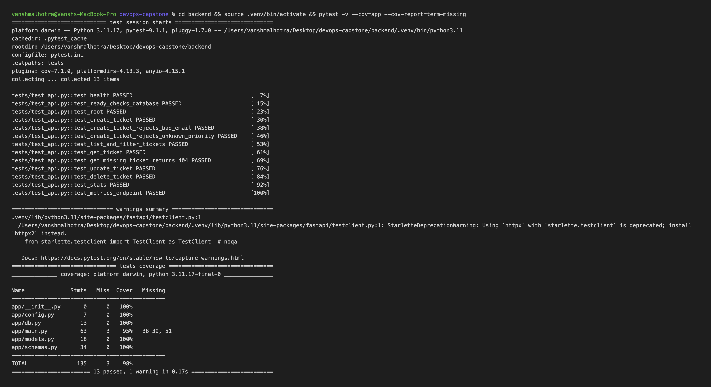

## 3. Deployment 1 — Docker Compose

```bash
docker compose up --build -d
docker compose logs backend postgres | grep -E 'alembic|Uvicorn|ready to accept'
```

The backend container runs `alembic upgrade head` (creates the `tickets` table) and then starts Uvicorn:

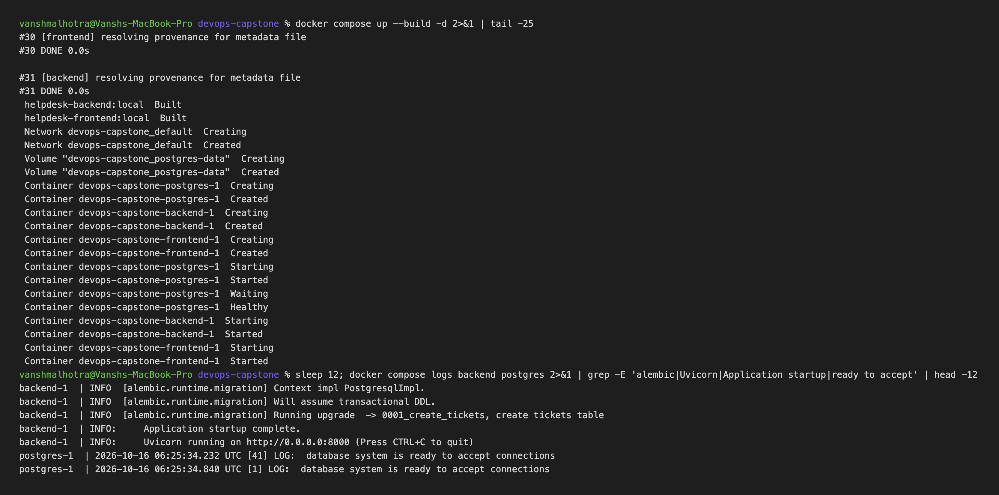

Three services are up. Both app images run as **non-root** (backend uid 10001, frontend nginx uid 101):

```bash
docker compose ps
docker images | grep helpdesk
docker compose exec backend id
docker compose exec frontend id
```

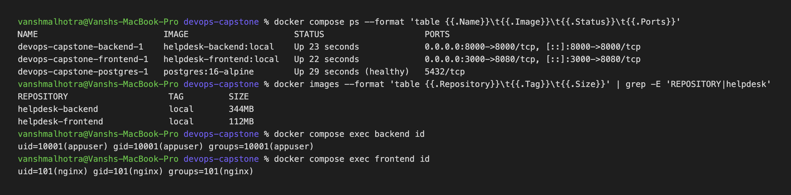

Health, readiness and Prometheus metrics:

```bash
curl -s localhost:8000/health
curl -s localhost:8000/ready
curl -s localhost:8000/metrics | grep http_requests_total
```

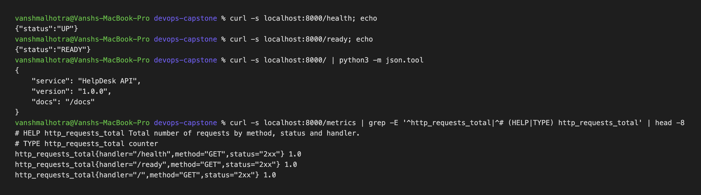

### REST API (Swagger UI at http://localhost:8000/docs)


**POST** `/api/tickets` → `201 Created`


**PUT** `/api/tickets/6` → `200 OK`

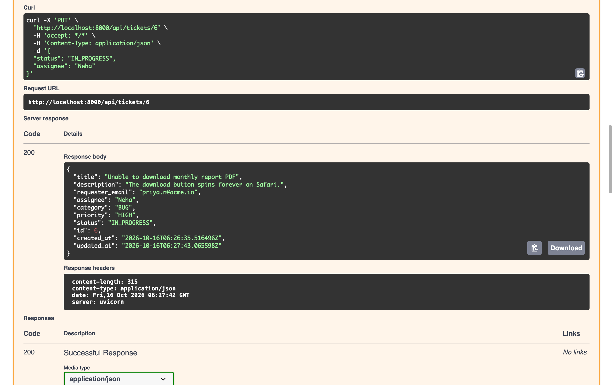

**DELETE** `/api/tickets/6` → `204 No Content`


### UI (http://localhost:3000)

Dashboard with KPI cards, status filters, ticket table with priority badges, activity feed and pipeline indicator:


Create-ticket modal:


Responsive layout: phone (390px — sidebar becomes a top bar, tickets become cards) and tablet (768px — icon sidebar, 2-up KPIs):

<p>

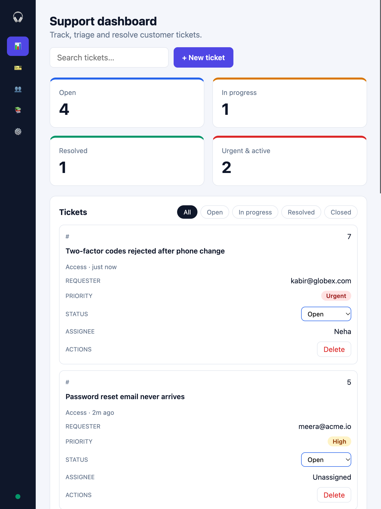
</p>

### Database (Alembic-managed table)

```bash
docker compose exec postgres psql -U helpdesk -d helpdesk -c '\dt'
docker compose exec postgres psql -U helpdesk -d helpdesk -c 'SELECT id, title, priority, status, assignee FROM tickets ORDER BY id;'
docker compose exec postgres psql -U helpdesk -d helpdesk -c 'SELECT * FROM alembic_version;'
```

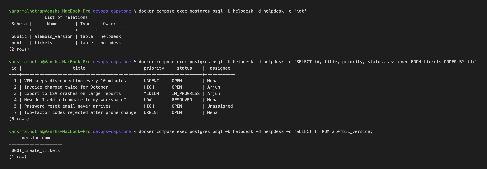

## 4. CI/CD — GitHub Actions

`.github/workflows/ci-cd.yml` runs on every push and pull request to `main`. Every job is a gate for the next:

```text
test ─┐
sast  ├─► build-scan-push ─► deploy (kind in CI) ─► gitops-bump
sca   │     (Trivy gate,       (helm --wait,          (tag → values-gitops.yaml,
secret│      then GHCR push)    rollout, smoke test)   Argo CD syncs it)
iac   │
tf   ─┘
```

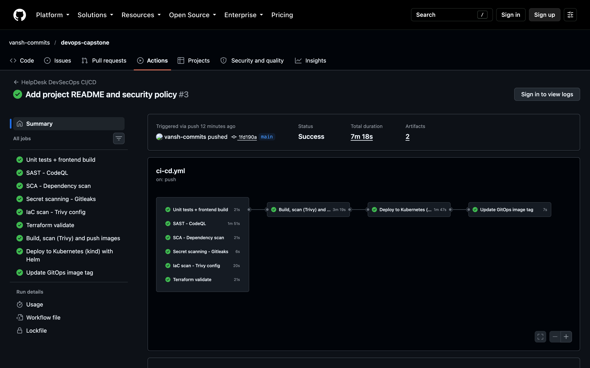

pytest runs in the pipeline (a failing test stops everything after it), then the React build:

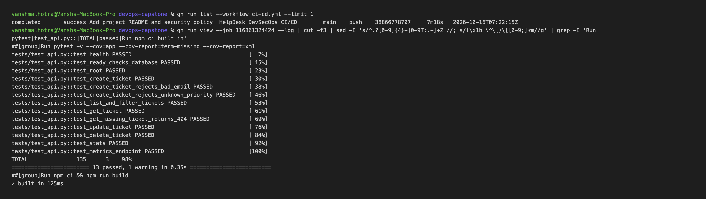

Images are pushed to GHCR **only after** the Trivy gate passes, tagged with the full commit SHA:

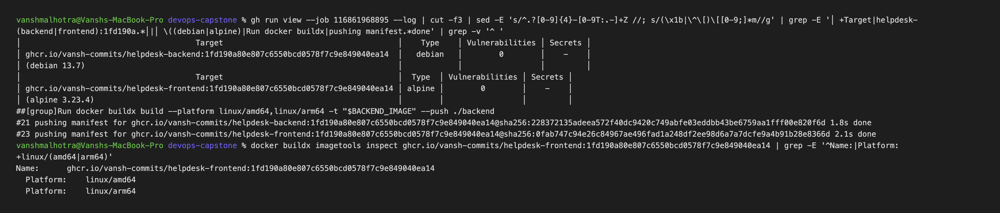

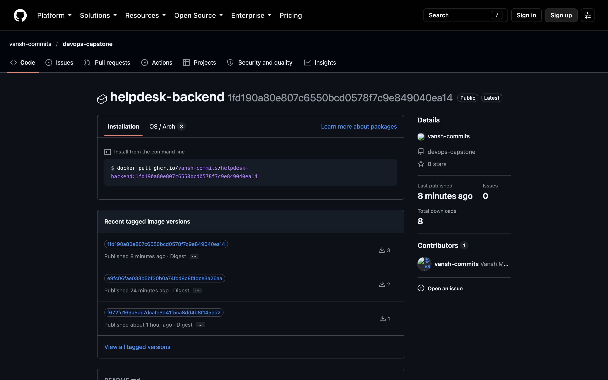

The deploy job installs the chart on a throwaway kind cluster with the new SHA, waits for the rollout and smoke-tests it:

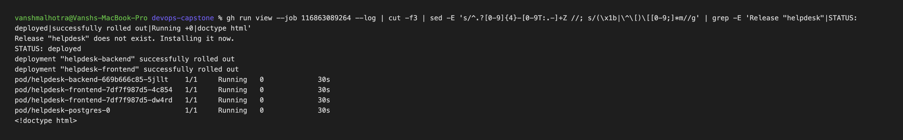

## 5. DevSecOps — security gates

| Layer | Tool | Result |
|---|---|---|
| SAST (our code) | CodeQL (Python + JavaScript) | 0 alerts |
| SCA (our dependencies) | pip-audit, npm audit | 0 vulnerabilities |
| Secrets | Gitleaks over the whole history + GitHub secret scanning/push protection | no leaks |
| IaC | `trivy config` (Terraform, Helm, Dockerfiles) | report only |
| Container images | `trivy image --severity HIGH,CRITICAL --ignore-unfixed --exit-code 1` | **blocking gate** |

In the pipeline:

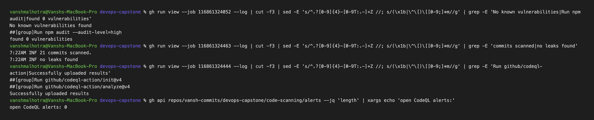

The same checks locally:

```bash
pip-audit -r backend/requirements.txt
(cd frontend && npm audit --audit-level=high)
docker run --rm -v "$PWD:/repo" ghcr.io/gitleaks/gitleaks:v8.28.0 git /repo --redact
```

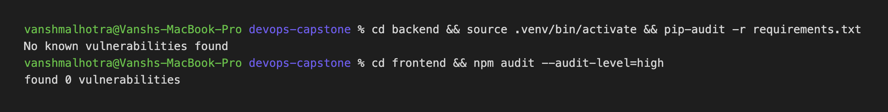

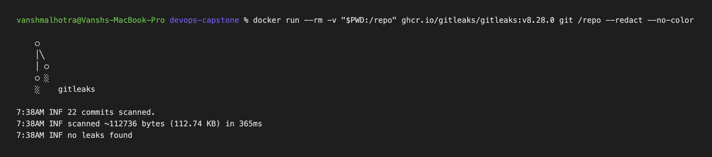

Trivy on the final images — both clean, exit code 0:

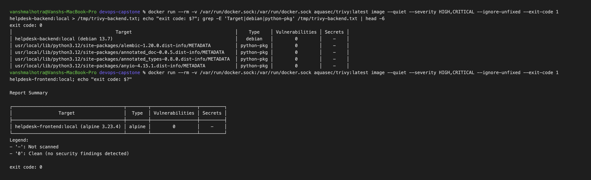

**The gate failing.** Removing the `apk upgrade` line from `frontend/Dockerfile` brings back the unpatched Alpine
packages. Trivy finds 43 HIGH CVEs and exits with code 1, so the pipeline stops and nothing is pushed:

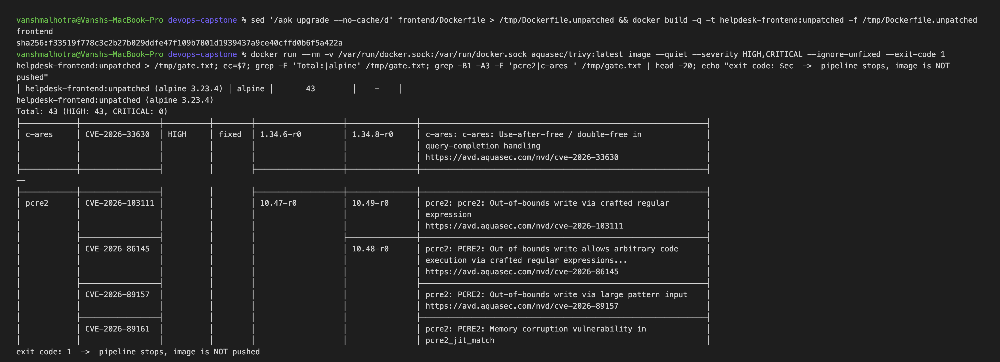

**What Trivy scanned and what it means.** Trivy scanned both final container images — the Debian-based
`python:3.12-slim` backend and the Alpine-based `nginx-unprivileged` frontend — checking OS packages and installed
Python libraries against CVE databases. The first scan of the frontend found fixable HIGH CVEs in Alpine packages,
for example **CVE-2026-86145 in `pcre2`**, an out-of-bounds write in the regular-expression library that can allow
code execution through a crafted pattern (fixed in `10.48-r0`). We remediated it by running `apk upgrade` in the
runtime stage of the Dockerfile; the re-scan reports **0** HIGH/CRITICAL findings, so the gate passes and the images
are published.

## 6. Terraform — AWS VPC + EKS

`terraform/` describes the production target: a VPC with 2 public + 2 private subnets across two AZs in
`ap-south-1`, a single NAT gateway and an EKS cluster with a managed node group (2 × t3.medium).
It is validated, not applied (an EKS cluster + NAT gateway cost money).

```bash
cd terraform
terraform init -backend=false
terraform fmt -check -recursive
terraform validate
```

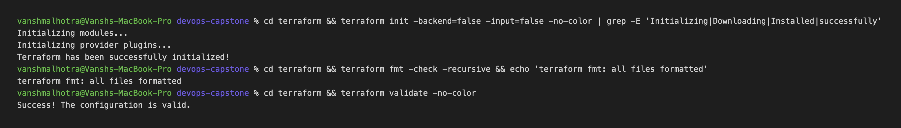

```bash
ls terraform && cat terraform/main.tf
```

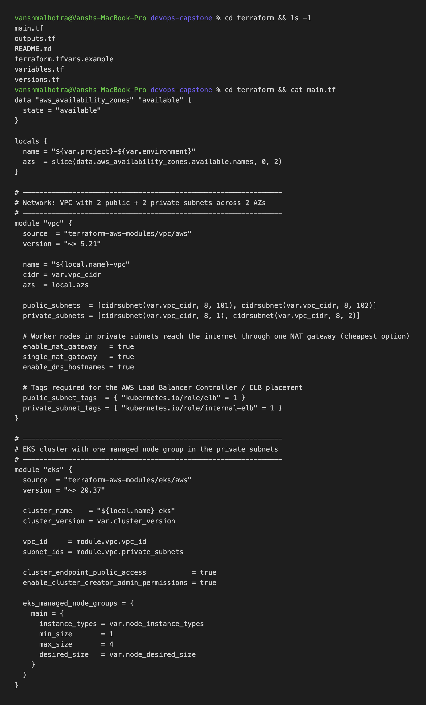

`terraform.tfvars.example` documents the inputs; real `*.tfvars` and state files are git-ignored and no AWS
credentials are committed. The pipeline runs `terraform fmt -check` and `terraform validate` on every push.

## 7. Deployment 2 — Kubernetes (kind) + Helm

Cluster prepared with ingress-nginx and metrics-server (`./scripts/kind-up.sh`), plus kube-prometheus-stack:

```bash
kubectl config use-context kind-project-cluster
./scripts/kind-up.sh
helm upgrade --install kube-prometheus-stack prometheus-community/kube-prometheus-stack \
  -n monitoring --create-namespace -f monitoring/prometheus-values.yaml
kubectl apply -f monitoring/grafana-dashboard.yaml
```

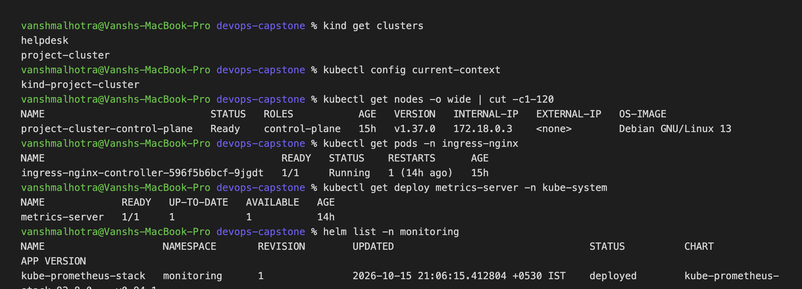

Load the local images into kind and install the chart:

```bash
docker compose build
kind load docker-image helpdesk-backend:local helpdesk-frontend:local --name project-cluster
kubectl apply -f k8s/namespace.yaml
helm upgrade --install helpdesk ./helm/helpdesk -n helpdesk -f helm/helpdesk/values-dev.yaml --wait
```

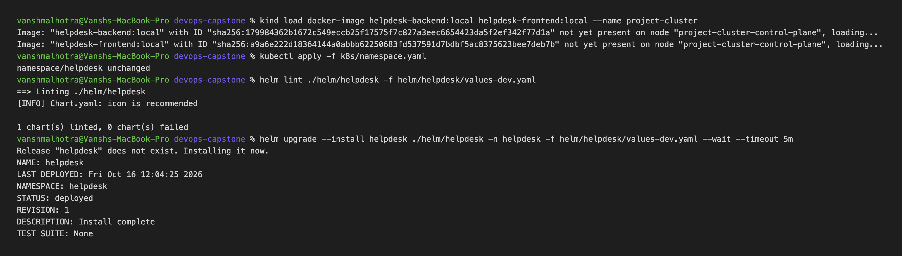

2 backend + 2 frontend replicas and PostgreSQL, all `Running`:

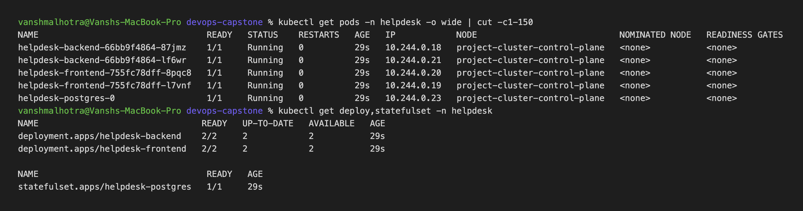

ClusterIP Services, Ingress (`/` → frontend, `/api` → backend), HPA, ConfigMap, Secret and PVC:

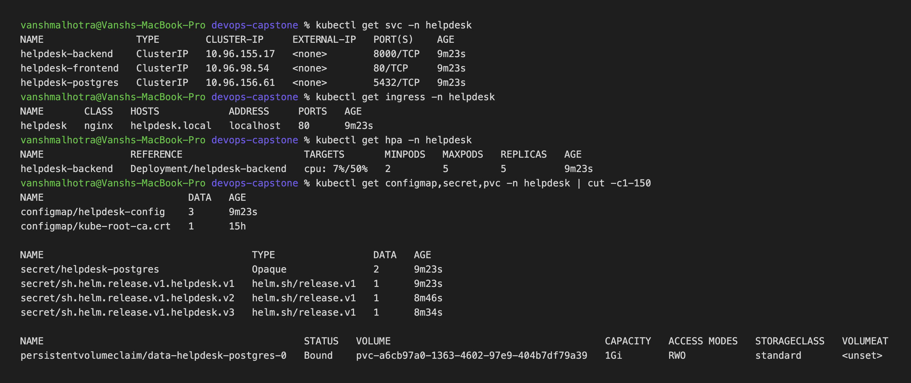

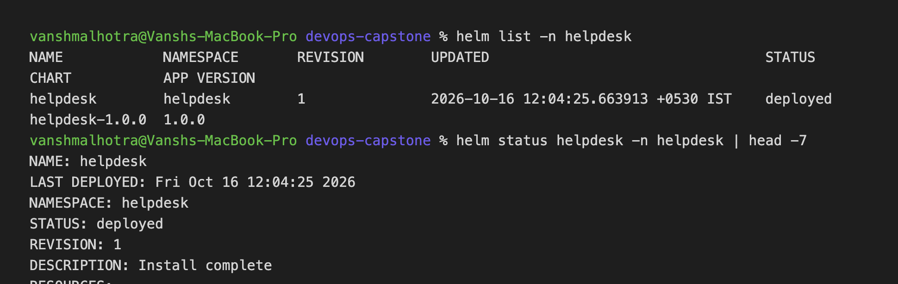

### Ingress

```bash
kubectl port-forward -n ingress-nginx svc/ingress-nginx-controller 8081:80
# /etc/hosts: 127.0.0.1 helpdesk.local gitops.helpdesk.local
```

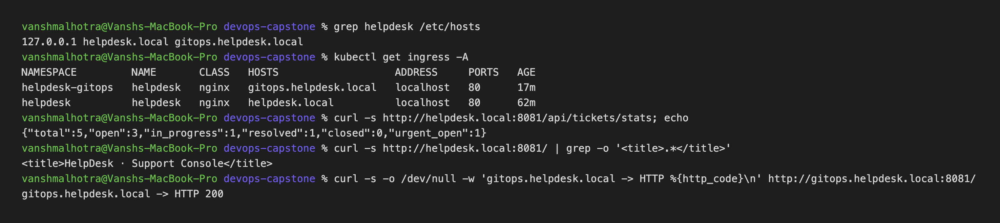

The app opened in the browser at **http://helpdesk.local:8081** (served through the Ingress):

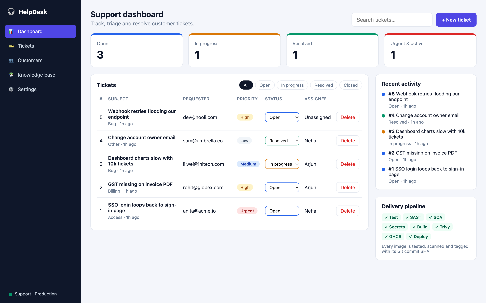

### Helm upgrade and rollback

```bash
helm upgrade helpdesk ./helm/helpdesk -n helpdesk -f helm/helpdesk/values-dev.yaml --set frontend.replicas=3 --wait
helm history helpdesk -n helpdesk
helm rollback helpdesk 1 -n helpdesk --wait
```

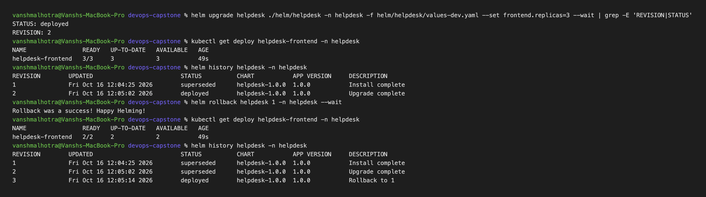

### HPA autoscaling

```bash
./scripts/load-test.sh http://helpdesk.local:8081/api/tickets/stats 30
kubectl get hpa -n helpdesk -w
```

CPU climbs past the 50% target and the backend scales 2 → 4 → 5 replicas:

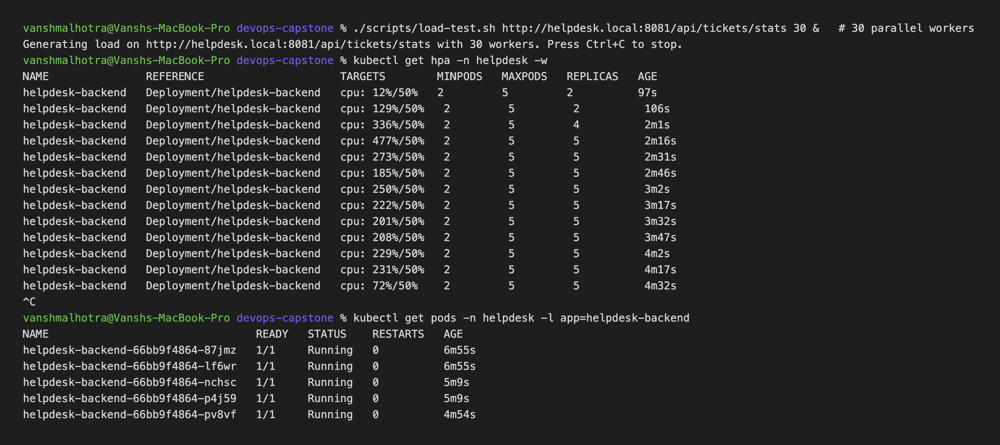

## 8. Monitoring — Prometheus + Grafana

```bash
kubectl port-forward -n helpdesk svc/helpdesk-backend 8001:8000 &
curl -s localhost:8001/metrics | grep http_requests_total
```

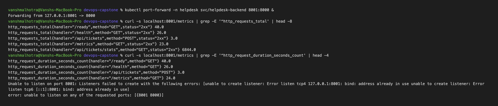

The chart's `ServiceMonitor` makes Prometheus scrape every backend pod — all 5 HPA replicas are **UP**
(`kubectl port-forward -n monitoring svc/kube-prometheus-stack-prometheus 9090:9090`):

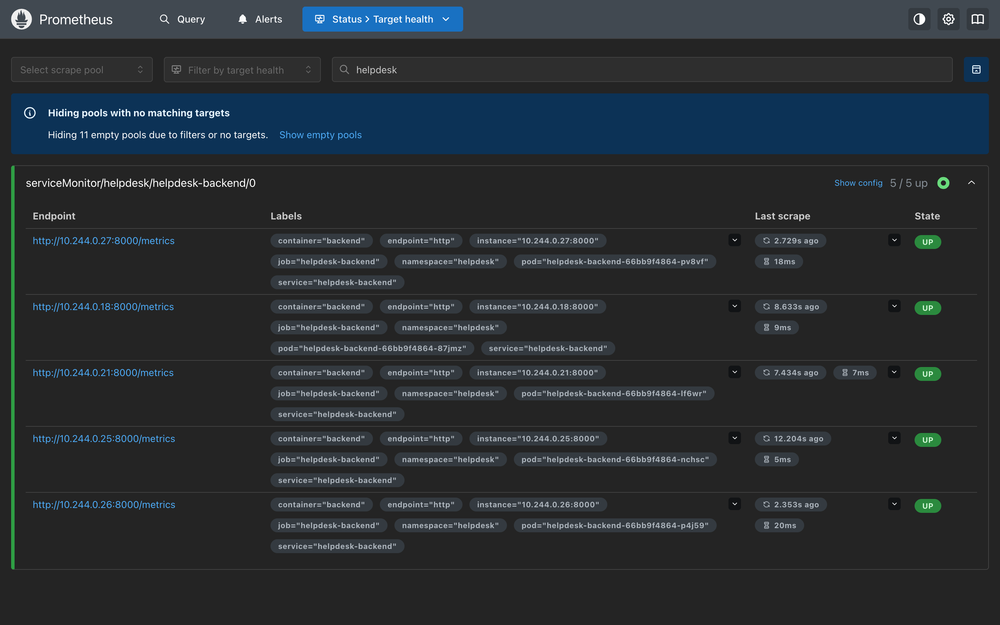

Grafana dashboard **HelpDesk API** (provisioned from `monitoring/grafana-dashboard.yaml`): requests/sec by
endpoint, p95 latency, 5xx error rate and backend replica count during the load test
(`kubectl port-forward -n monitoring svc/kube-prometheus-stack-grafana 3001:80`):


## 9. Troubleshooting lab

```bash
./troubleshooting/triage_all.sh
```

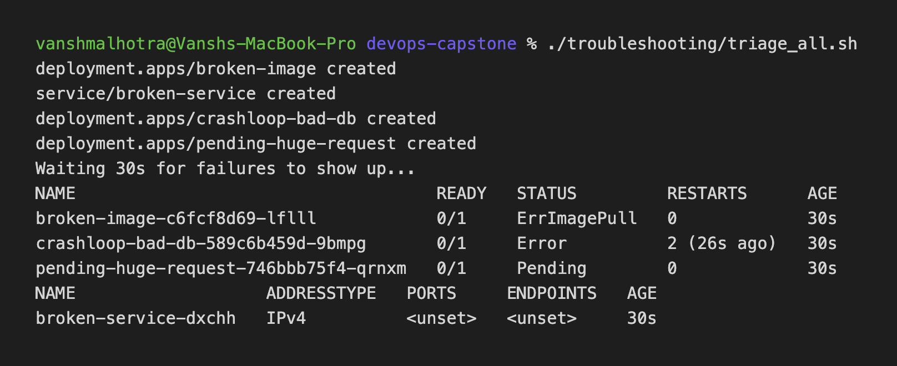

| Symptom | Diagnosis | Root cause | Fix |
|---|---|---|---|
| `ErrImagePull` | `kubectl describe pod` → image not found | tag does not exist | `kubectl set image deployment/broken-image -n helpdesk web=helpdesk-frontend:local` |
| `CrashLoopBackOff` | `kubectl logs --previous` → `failed to resolve host 'postgres-typo'` | wrong `DATABASE_URL` | `kubectl set env deployment/crashloop-bad-db -n helpdesk DATABASE_URL=...@helpdesk-postgres:5432/helpdesk` |
| `Pending` | `kubectl describe pod` → `Insufficient cpu` | requests 64 CPUs | `kubectl set resources deployment/pending-huge-request -n helpdesk --requests=cpu=50m,memory=32Mi` |
| Service has no endpoints | `kubectl get endpoints` → `<none>` vs `--show-labels` | selector `app=helpdesk-api` matches nothing | `kubectl patch svc broken-service -n helpdesk -p '{"spec":{"selector":{"app":"helpdesk-backend"}}}'` |

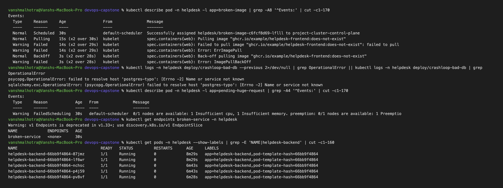

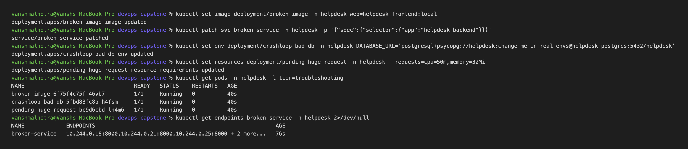

## 10. Deployment 3 — Argo CD (GitOps)

Argo CD watches `helm/helpdesk` on `main` with `values-gitops.yaml`. After every green pipeline the `gitops-bump`
job writes the new commit SHA into that file, and Argo CD rolls it out to the `helpdesk-gitops` namespace.

```bash
kubectl create namespace argocd
kubectl apply -n argocd --server-side --force-conflicts \
  -f https://raw.githubusercontent.com/argoproj/argo-cd/stable/manifests/install.yaml
kubectl apply -f argocd/helpdesk-application.yaml
kubectl port-forward svc/argocd-server -n argocd 8080:443
```

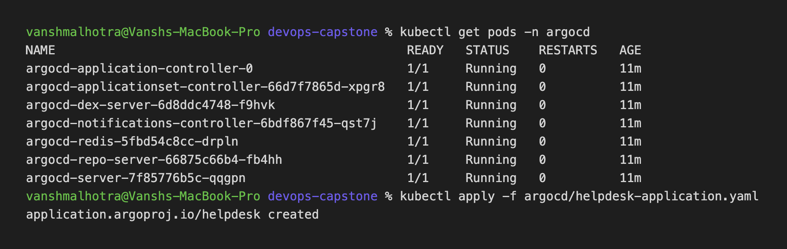

**Commit → pipeline → deployment update (M10).** Pushing commit `1fd190a` ran the pipeline; the `gitops-bump` job
committed that SHA into `values-gitops.yaml`, and Argo CD rolled it out — the running images carry exactly that tag:

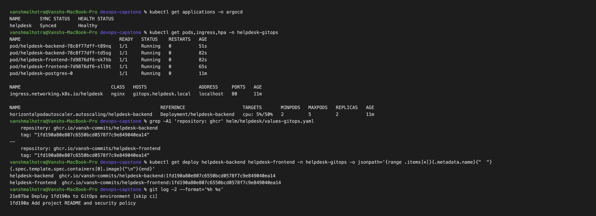

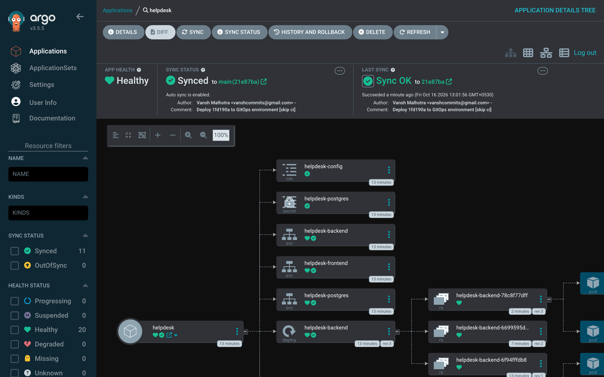

The GitOps-managed copy of the app at **http://gitops.helpdesk.local:8081**:

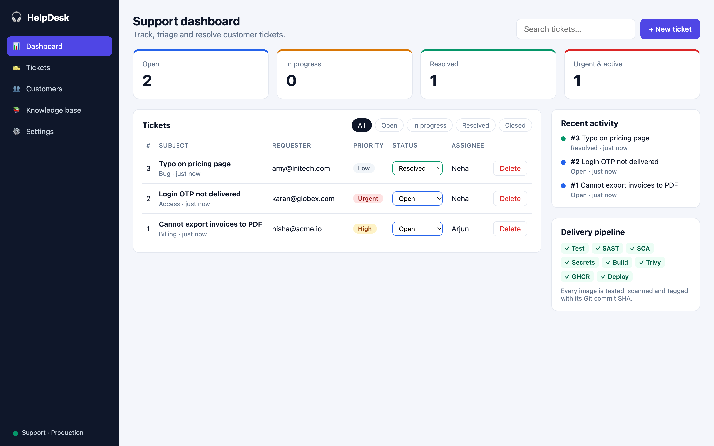

### Self-healing

A manual `kubectl scale` is reverted because Git is the desired state:

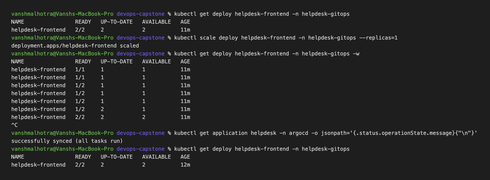

## Teardown

```bash
kubectl delete -f argocd/helpdesk-application.yaml
helm uninstall helpdesk -n helpdesk
helm uninstall kube-prometheus-stack -n monitoring
kubectl delete namespace helpdesk helpdesk-gitops monitoring argocd
docker compose down -v
```
